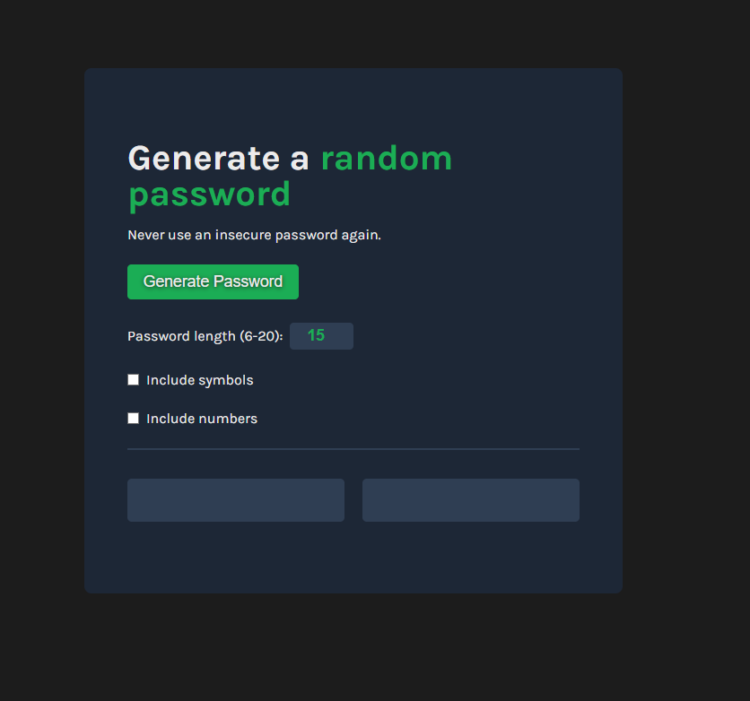

# Scrimba - Password Generator solo project

This is a solution to the [Password Generator on Scrimba](https://scrimba.com/learn-javascript-c0v/~03f). Scrimba solo projects helps you improve your coding skills by building realistic projects. 

### The challenge

Users should be able to:

- Set password length
- copy-on-click
- check "symbols" and "numbers on/off

### Screenshot



### Links

- Live Site URL: [Netlify](https://passwords-generator-scrimba-byfilip.netlify.app)

### Built with

- Semantic HTML5 markup
- CSS custom properties
- Flexbox
- Vanilla JavaScript

### What I learned

Building this Password Generator was a great exercise. Two core concepts I practiced and implemented in this project were:

- **Conditional Copy-on-Click with the Clipboard:** I learned how to use `navigator.clipboard.writeText()` to let users copy generated passwords with a single click. To prevent copying empty containers before any password is generated, I introduced a boolean state flag (`copyPasswordReady`) that unlocks the copy functionality and dynamically adds a `.pointer` cursor class once the first passwords are created.
- **Dynamically Expanding and Shrinking Arrays:** Instead of hardcoding multiple character sets, I used a base `customArray` initialized with letters and adjusted it dynamically via `prepareArray()` before every generation. Depending on whether the **Numbers** or **Symbols** checkboxes are checked, the array either expands using the spread operator (`customArray.push(...numbers)`) or shrinks by filtering out unwanted characters (`customArray.filter(...)`).

Here are the exact code snippets from `script.js` handling both features:

```js
// Unlocking copy functionality and copying password text on click
function copyPassword(element) {
    if (copyPasswordReady) {
        navigator.clipboard.writeText(document.getElementById(element).textContent)
    }
}

// Expanding or shrinking customArray based on checkbox states
function prepareArray() {
    if (includeNumbersEl.checked) {
        // add numbers to array
        customArray.push(...numbers)
    } else {
        // remove numbers from array
        customArray = customArray.filter(char => !numbers.includes(char))
    }

    if (includeSymbolsEl.checked) {
        // add symbols to array
        customArray.push(...symbols)
    } else {
        // remove symbols from array
        customArray = customArray.filter(char => !symbols.includes(char))
    }
}
```
## Author

- Website - [Filip Szkarlat Szczepaniak](https://filipszkarlatportfolio.netlify.app)
- Scrimba - [@Filip Szkarlat Szczepaniak](https://scrimba.com/u01afpl)
- LinkedIn - [@Filip Szkarlat Szczepaniak](https://www.linkedin.com/in/filip-szkarlat-szczepaniak/)
